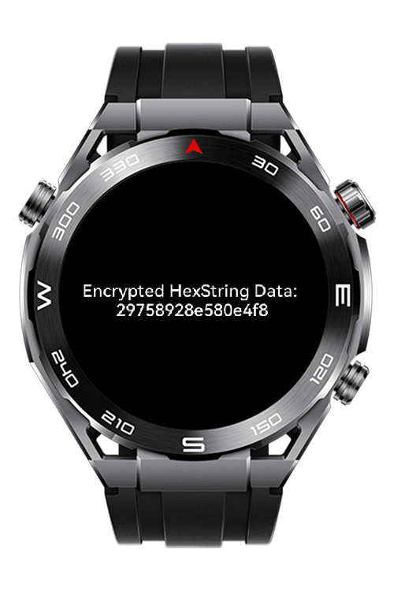

> **Note:** To access all shared projects, get information about environment setup, and view other guides, please visit [Explore-In-HMOS Index](https://github.com/Explore-In-HMOS/hmos-index).

# How to Implement 3DES Encryption using HUKS on Huawei Sport Lite Wearables

This project is a HarmonyOS demo application that showcases how to implement **3DES (Triple DES)** encryption using the **Huawei HUKS security framework**.  
It focuses on secure data encryption via imported cryptographic keys, session handling, and byte-level data conversion for wearable devices.
This example use existing key import.

# Preview
<div>
    
</div>

# Use Cases
This application demonstrates:
- Encrypting data using the **3DES algorithm**
- Importing cryptographic keys into **HUKS**
- Managing secure encryption sessions
- Converting data between **Hex** and **Uint8Array** formats for compatibility

# Tech Stack
- **Languages**:  JavaScript (Huawei LiteWearable)
- **Tools**:  Huawei DevEco Studio IDE 5.1.1.840
- **Libraries**: [`@ohos.security.huks`](https://developer.huawei.com/consumer/en/doc/harmonyos-references/js-apis-huks)

# Directory Structure
```
entry/src/main/ets/
│
├── CryptoHelper.js           // Core cryptographic logic using HUKS
├── pages/
│   ├── Index.js              
│   ├── Index.hml            
│   └── Index.css            
```

# Constraints and Restrictions
## Supported Devices
- Huawei Sport (Lite) Watch GT 4/5
- Huawei Sport (Lite) GT4/5 Pro
- Huawei Sport (Lite) Fit 3/4
- Huawei Sport (Lite) D2
- Huawei Sport (Lite) Ultimate

# License
**How to Implement 3DES Encryption using HUKS on Huawei Sport Lite Wearables** is released under the MIT License.  
See the [LICENSE](/LICENSE) file for details.
